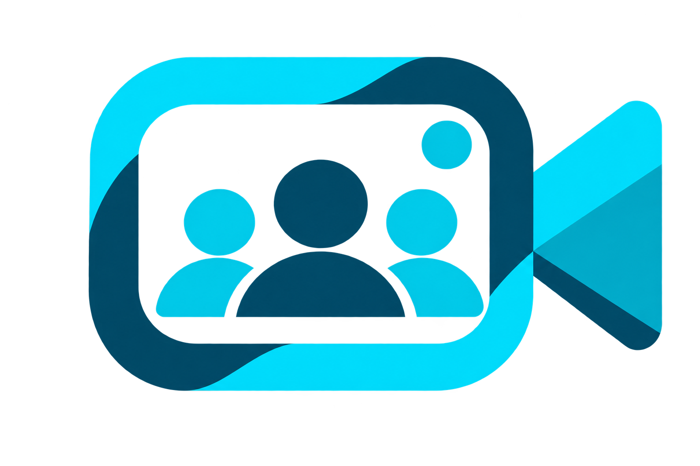

<p align="center">
  
</p>

<h1 align="center">Gravaai</h1>

<p align="center">
  <strong>Record your screen. Record your meetings. Keep everything local.</strong><br />
  An offline screen recorder, video editor and meeting note-taker for Linux on Wayland: COSMIC, KDE Plasma and GNOME.
</p>

<p align="center">
  
  <a href="LICENSE"></a>
</p>

---

## What it does

Gravaai has two modes, both started from the same floating HUD:

- **Screen recording** — capture a monitor with microphone, system audio, cursor and webcam, then polish it in a timeline editor and export MP4 or GIF.
- **Meeting mode** — record audio only, get a Markdown transcript, and generate structured notes with a local model or an OpenAI-compatible API.

There are no accounts, no telemetry and no cloud sharing. Recordings, projects, transcripts and exports stay on your machine.

## Supported desktops

Wayland only. Each desktop is tested by recording in the real session.

| Desktop | Capture | Cursor and clicks | Stop from the desktop | Global shortcuts |
| --- | --- | --- | --- | --- |
| COSMIC | Native (ext-image-copy-capture); **Pick screen** picks the monitor you click | Native helper | HUD | Written into COSMIC keyboard settings |
| KDE Plasma 6 | xdg-desktop-portal; KDE's share dialog the first time, remembered after | KWin script | "End" in the screen-sharing indicator | GlobalShortcuts portal (Ctrl+Alt+R) |
| GNOME 45+ (tested on 51) | xdg-desktop-portal; GNOME's share dialog the first time, remembered after | `gravaai-cursor` shell extension, installed and enabled by the app | Stop button in the top-bar sharing indicator | GlobalShortcuts portal on GNOME 48+ (not yet verified) |

On GNOME the cursor extension is installed on the first recording; Wayland only loads it after you log out and back in once, so that first recording has no cursor track. Click capture on every desktop needs your user in the `input` group.

## Screen recording

### Capture

- Native COSMIC Wayland capture (ext-image-copy-capture), including rotated monitors; **Pick screen** selects the monitor you click on
- On KDE Plasma, GNOME and other portal-only Wayland desktops the same pipeline runs over the xdg-desktop-portal ScreenCast (PipeWire) stream; there the system's own screen-sharing dialog picks the monitor the first time and is remembered after that, and ending the share from the desktop's indicator saves the recording
- Microphone and system audio through PipeWire/PulseAudio, kept in sync with the video
- Cursor position and clicks recorded by a native helper, so auto-zoom and the cursor overlay work on Wayland (on KDE Plasma the position comes from a KWin script, on GNOME from a small shell extension the app installs itself)
- Global recording shortcuts: written into COSMIC's keyboard settings, or registered through the desktop's GlobalShortcuts portal on KDE Plasma and GNOME 48+
- Webcam overlay
- Recording opens straight into the editor

### Editing

- Drag-and-drop timeline with trims, speed regions and extra audio tracks
- Manual zooms plus automatic zoom suggestions from cursor activity
- Glass loupe: a circular magnifying glass that follows the cursor, placed automatically when a
  click is held for more than 200 ms
- Text, image and shape annotations
- Crop and aspect-ratio presets
- Rendered cursor with size, smoothing, motion blur, click bounce and loop mode
- Webcam mirror, size, position, split screen (camera beside or above/below the video), roundness, shadow and zoom-reactive scaling
- Wallpapers, colors, gradients, padding, rounded corners, blur and shadows
- Auto-captions with a local Whisper model
- Projects saved as `.gravaai` files: save while editing with **Ctrl + S** (⌘ S) or the **Save**
  button in the header, next to Export — a recording that just opened can be named and saved right
  away

### Export

- MP4 and GIF to a local file, with quality, frame-rate and size presets

## Meeting mode

- Audio-only recording of microphone and system audio
- Local Whisper transcription saved as Markdown, with silence guarding so quiet stretches don't produce invented text
- Notes — summary, decisions, action items — from a local model or any OpenAI-compatible API
- A Meetings library to browse, re-transcribe and regenerate notes

## AI control (MCP)

Gravaai can let an outside agent — Claude Code, Claude Desktop, any MCP client — edit the open project from a prompt. There is no prompt box and no model inside the app: it only exposes five tools (`inspect`, `edit`, `frames`, `project`, `job`).

It is **off by default**. Turn it on in **Settings → AI control**, then copy the shown command:

```bash
claude mcp add gravaai -- <path-to-gravaai> --mcp
```

- The bridge (`gravaai --mcp`) speaks MCP over stdio and talks to the running app over a **local socket** in the app's data folder — never a TCP port.
- Every connection needs the per-install token stored next to that socket (`agent-token`, mode 0600). *Regenerate token* invalidates existing agents.
- Changes go through the open editor: they appear on the timeline, land in undo history as `AI: …`, and can be reverted from the header chip or with `edit {"ops":[{"op":"revert_ai"}]}`.

## Build from source

Prerequisites (Pop!_OS / Ubuntu):

```bash
sudo apt install build-essential cmake libwayland-dev pulseaudio-utils
# plus, for the KDE/GNOME/wlroots (xdg-desktop-portal) capture backend:
sudo apt install libpipewire-0.3-dev libdbus-1-dev
```

Your user must be in the `input` group for click capture.

```bash
git clone https://github.com/jmarceno/Gravaai.git gravaai
cd gravaai/java
./mvnw -T1 -Pdist package
```

The AppImage is written to `/media/jmarceno/scratch/java-targets/gravaai-app/dist/Gravaai-linux-x64.AppImage`. See [java/README.md](java/README.md) for tests and development flags.

## Network use

Gravaai works offline. It goes online only when you ask it to:

- download a Whisper model for captions or transcripts;
- send a transcript to the notes API you configured;
- add a custom font from Google Fonts.

## License

Gravaai is licensed under the **MIT**. See [LICENSE.md](LICENSE.md).

The bundled wallpapers, animated wallpaper and recording icon are either original Gravaai
artwork or CC0 1.0 public-domain works. See [ASSETS.md](ASSETS.md) for the per-asset
provenance and licenses.

## Credits

Gravaai was inspired by [@webadderall](https://github.com/webadderall) by [OpenScreen](https://github.com/siddharthvaddem/openscreen) by Siddharth Vaddem.
